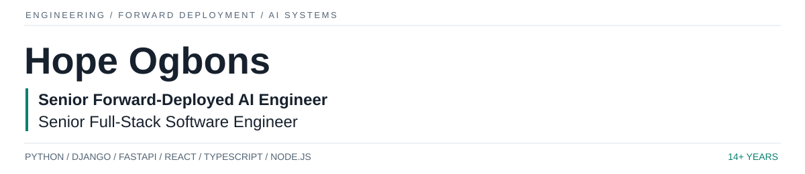
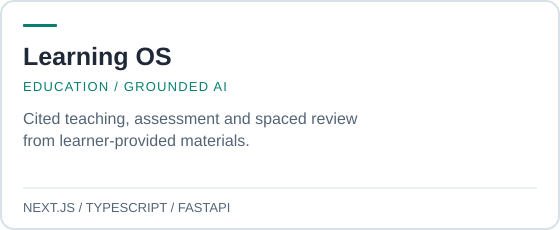
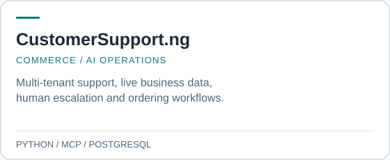
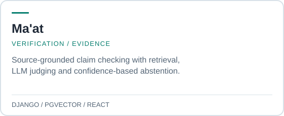
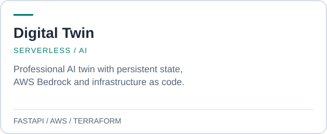

<!-- Hope Ogbons · Theme-adaptive GitHub profile · November 2026 -->

<picture>
  <source media="(prefers-color-scheme: dark)" srcset="assets/portfolio-hero-dark.svg" />
  <source media="(prefers-color-scheme: light)" srcset="assets/portfolio-hero-light.svg" />
  
</picture>

**Building reliable AI systems and full-stack products - from architecture to production.**

Senior Forward-Deployed AI Engineer · Senior Full-Stack Software Engineer · Founder

[**Selected Work**](#selected-work) &nbsp; · &nbsp; [**Engineering Impact**](#engineering-impact) &nbsp; · &nbsp; [**LinkedIn**](https://www.linkedin.com/in/hopeogbons) &nbsp; · &nbsp; [**RoboOffice**](https://robooffice.ltd) &nbsp; · &nbsp; [**Contact**](mailto:hopeogbons@gmail.com)

---

### Profile

I’m a **Senior Forward-Deployed AI Engineer** and **Senior Full-Stack Software Engineer** with **14+ years** building software for healthcare, enterprise operations, and public-sector initiatives.

I specialize in **advanced Python**, **Django**, **FastAPI**, **React**, **TypeScript**, and **Node.js**. My AI engineering practice spans agent orchestration, MCP, retrieval-augmented generation, tool execution, evaluation and observability. I build across the entire stack and work closely with domain experts to turn complex problems into maintainable, production-ready systems.

**What I bring:** end-to-end engineering · forward deployment · technical leadership · product delivery.

### Selected work

<a href="https://github.com/hopeogbons/learningOS"><picture><source media="(prefers-color-scheme: dark)" srcset="assets/project-learning-dark.svg" /><source media="(prefers-color-scheme: light)" srcset="assets/project-learning-light.svg" /></picture></a>
<a href="https://customersupport.ng"><picture><source media="(prefers-color-scheme: dark)" srcset="assets/project-support-dark.svg" /><source media="(prefers-color-scheme: light)" srcset="assets/project-support-light.svg" /></picture></a>

<a href="https://github.com/hopeogbons/maat"><picture><source media="(prefers-color-scheme: dark)" srcset="assets/project-maat-dark.svg" /><source media="(prefers-color-scheme: light)" srcset="assets/project-maat-light.svg" /></picture></a>
<a href="https://github.com/hopeogbons?tab=repositories"><picture><source media="(prefers-color-scheme: dark)" srcset="assets/project-twin-dark.svg" /><source media="(prefers-color-scheme: light)" srcset="assets/project-twin-light.svg" /></picture></a>

Selected portfolio work includes publicly accessible code and commercial systems whose source may be private.

### Technical depth

**AI engineering** - Multi-agent workflows, OpenAI Agents SDK, LangGraph, MCP, RAG, embeddings, pgvector, LLM-as-judge, structured outputs, confidence gates, Langfuse, OpenTelemetry.

**Python & backend** - Advanced Python, Django, FastAPI, asyncio, Pydantic, Celery, Redis, PostgreSQL, background processing, API design, distributed workflows.

**JavaScript & frontend** - JavaScript, TypeScript, React, Next.js, Node.js, Redux Toolkit, Redux-Saga, GraphQL, REST, application architecture.

**Cloud & infrastructure** - AWS Lambda, Bedrock, S3, SQS, App Runner, Terraform, Docker, CI/CD, observability and secure integrations.

### Engineering impact

- **Public health · eHealth Africa:** Led six engineers building USSD-based reporting that let vaccination field workers submit data without internet access.
- **Operational improvement · eHealth Africa:** Led four engineers developing GPS-aware ODK reporting. Monthly RISS submissions increased from **1,156 (Jan 2018)** to **13,812 (Dec 2018)**.
- **Healthcare platforms · Headspace / Medable:** Owned frontend architecture for Headspace Care scheduling and contributed clinical-trial and telehealth developer tooling.
- **Enterprise systems · Groove Labs:** Led a four-engineer squad delivering CRM and VoIP features spanning the UI and backend.
- **Performance · Syssoft Consultants:** Parallelized insurance calculations; a batch that had taken hours completed in approximately **25 minutes**.
- **Applied AI · RoboOffice:** Designed multi-tenant and agentic software incorporating authorized tool execution, source-grounded answers, durable orchestration and escalation.

### Experience

| Organization | Responsibility | Period |
|:--|:--|:--|
| **RoboOffice Ltd** | CEO, Co-Founder & Forward-Deployed AI Engineer | May 2023 - Present |
| **Andela** | Senior Software Engineer, Forward-Deployed | May 2019 - Present |
| **eHealth Africa** | Software Developer Coordinator | Feb 2017 - Mar 2019 |
| **RoboOffice Ltd** | Co-Founder & Principal Engineer | Apr 2014 - Dec 2016 |
| **Syssoft Consultants Limited** | Software Engineer | Dec 2010 - Mar 2014 |

### Credentials

- **CCAO Foundations** - Claude Certified Associate · **Certified**
- **CCDV Foundations** - Claude Certified Developer · **Certified**
- **CCAR Foundations** - Claude Certified Architect · **Certified**
- **CCARP** - Claude Certified Architect Professional · **In Progress**
- **Proficient AI Engineer** - Ed Donner · **Completed (2026)**

### Education

**BSc Computing**, University of Portsmouth, UK · **Professional Diploma in Software Engineering**, NIIT · **Diploma in Computer Technology**, Obafemi Awolowo University.

---

**Thoughtful engineering. Reliable AI. Measurable outcomes.**

[GitHub repositories](https://github.com/hopeogbons?tab=repositories) &nbsp;·&nbsp; [LinkedIn](https://www.linkedin.com/in/hopeogbons) &nbsp;·&nbsp; [RoboOffice](https://robooffice.ltd) &nbsp;·&nbsp; [Email](mailto:hopeogbons@gmail.com)

