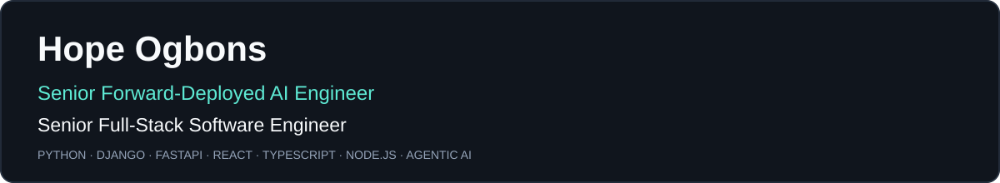

<!-- Hope Ogbons · Executive AgentFolio GitHub Profile · November 2026 -->

  

 

<table>
<tr>
<td width="190" valign="top" align="center">

</td>
<td valign="top">
<h2>Engineering that moves beyond prototypes.</h2>

I'm a <strong>Senior Forward-Deployed AI Engineer</strong> and <strong>Senior Full-Stack Software Engineer</strong> with <strong>14+ years of experience</strong> delivering production systems across healthcare, enterprise software, public health, and AI.

I design, build, deploy, and operate <strong>reliable agentic systems</strong>, sophisticated Python backends, and modern full-stack applications. My core strengths are <strong>Python, Django, FastAPI, React, TypeScript, and Node.js</strong>.

<a href="https://www.linkedin.com/in/hopeogbons">LinkedIn</a> &nbsp;·&nbsp; <a href="https://robooffice.ltd">RoboOffice</a> &nbsp;·&nbsp; <a href="mailto:hopeogbons@gmail.com">Email</a> &nbsp;·&nbsp; <a href="https://github.com/hopeogbons?tab=repositories">Repositories</a>

</td>
</tr>
</table>

<strong>14+ years engineering</strong> &nbsp; | &nbsp; <strong>AI + Full Stack</strong> &nbsp; | &nbsp; <strong>Engineering Leadership</strong> &nbsp; | &nbsp; <strong>Founder</strong>

---

## About

I build intelligent systems that retrieve and verify evidence, reason through multi-step workflows, safely use authorized tools, and abstain when the evidence is insufficient. I combine production software engineering with AI delivery: clear contracts, structured outputs, evaluation, tracing, tenant isolation, retries, and human approval where it matters.

My engineering background extends far beyond AI: I have designed full-stack systems, led engineering teams, and built technology for international enterprise and healthcare products.

- **Forward-deployed AI:** Agent orchestration, MCP tool integrations, RAG, source grounding, LLM evaluation, LangGraph, and OpenAI Agents SDK.
- **Advanced Python:** Django, FastAPI, asynchronous processing, state machines, schema-driven services, and durable background jobs.
- **Full-stack engineering:** JavaScript, TypeScript, React, Next.js, Node.js, REST, GraphQL, PostgreSQL, and application architecture.
- **Cloud and reliability:** AWS Bedrock, Lambda, S3, SQS, Terraform, Docker, Redis, Celery, Langfuse, and OpenTelemetry.
- **Leadership:** Technical strategy, team mentoring, stakeholder engagement, and delivery of complex products.

---

## Featured Projects

<table>
<tr>
<td width="50%" valign="top">
<h3><a href="https://github.com/hopeogbons/learningOS">Learning OS</a></h3>
<strong>Source-grounded learning platform</strong>

Converts learner-provided content into cited teaching, recall checks, confidence-aware assessments, and spaced review. Includes durable worker jobs and engineering quality checks.

Next.js · TypeScript · FastAPI · Python
</td>
<td width="50%" valign="top">
<h3><a href="https://customersupport.ng">CustomerSupport.ng</a></h3>
<strong>AI customer support and commerce</strong>

Multi-tenant AI support grounded in business documents and live data, with an embeddable widget, human escalation, Telegram notifications, and commerce workflows.

Agentic AI · MCP · Python · PostgreSQL
</td>
</tr>
<tr>
<td width="50%" valign="top">
<h3><a href="https://github.com/hopeogbons/maat">Ma'at</a></h3>
<strong>Evidence-grounded claim verification</strong>

Claim assessment using retrieval, reranking, LLM judgement, and a confidence gate designed to abstain rather than guess when evidence is weak.

Django · pgvector · React · LLM evaluation
</td>
<td width="50%" valign="top">
<h3>Digital Twin</h3>
<strong>Serverless AI application</strong>

Professional AI twin powered by FastAPI and AWS Bedrock, with S3-backed state, AWS Lambda, API Gateway, and infrastructure provisioned in Terraform.

Python · FastAPI · AWS · Terraform
</td>
</tr>
</table>

Some commercial projects and client systems are proprietary or not publicly available.

---

## Technical Expertise

| Discipline | Core Capabilities |
|:--|:--|
| **AI & Agents** | Agentic workflows, MCP, multi-agent orchestration, LangGraph, RAG, embeddings, retrieval, reranking, LLM evaluation, structured outputs |
| **Python & Backend** | Advanced Python, Django, FastAPI, Pydantic, asyncio, Celery, Redis, PostgreSQL, pgvector |
| **JavaScript & Full Stack** | React, TypeScript, JavaScript, Node.js, Next.js, Redux Toolkit, Redux-Saga, GraphQL, REST APIs |
| **Cloud & Infrastructure** | AWS Lambda, Bedrock, S3, SQS, App Runner, Docker, Terraform, CI/CD |
| **Reliability** | Observability, OpenTelemetry, Langfuse, tests, traceability, validation, retries, access control |

---

## Selected Engineering Impact

- **Public health:** Led a six-engineer team building USSD reporting that enabled vaccination field workers to submit data without internet access.
- **Operational scale:** Led a four-engineer team building GPS-aware ODK tools; monthly RISS submissions increased from **1,156 in January 2018 to 13,812 in December 2018**.
- **Healthcare:** Owned frontend architecture for **Headspace Care** appointment scheduling and contributed telehealth and clinical-trial tooling for **Medable / Medici**.
- **Enterprise systems:** Led a four-engineer squad delivering CRM and VoIP capabilities at **Groove Labs**.
- **Performance engineering:** Parallelized insurance calculation workflows at **Syssoft Consultants**, reducing a batch that previously took hours to roughly **25 minutes**.
- **Applied AI:** Developed production-oriented systems for agent orchestration, grounded support, claim verification, and enterprise tool integration.

---

## Professional Experience

| Organization | Role | Period |
|:--|:--|:--|
| **RoboOffice Ltd** | CEO, Co-Founder & Forward-Deployed AI Engineer | May 2023 – Present |
| **Andela** | Senior Software Engineer, Forward-Deployed | May 2019 – Present |
| **eHealth Africa** | Software Developer Coordinator | Feb 2017 – Mar 2019 |
| **RoboOffice Ltd** | Co-Founder & Principal Engineer | Apr 2014 – Dec 2016 |
| **Syssoft Consultants Limited** | Software Engineer | Dec 2010 – Mar 2014 |

---

## Certifications & Professional Development

| Credential | Status |
|:--|:--|
| **CCAO Foundations — Claude Certified Associate** | **Certified** |
| **CCDV Foundations — Claude Certified Developer** | **Certified** |
| **CCAR Foundations — Claude Certified Architect** | **In Progress** |
| **Proficient AI Engineer — Ed Donner** | **Completed, 2026** |

## Education

- **BSc Computing** — University of Portsmouth, United Kingdom
- **Professional Diploma, Software Engineering** — NIIT, Nigeria
- **Diploma, Computer Technology** — Obafemi Awolowo University, Nigeria

---

### Building software that delivers real-world results.

**Senior Forward-Deployed AI Engineering · Senior Full-Stack Engineering · Technical Leadership**

[**Explore my repositories**](https://github.com/hopeogbons?tab=repositories) &nbsp; · &nbsp; [**Connect on LinkedIn**](https://www.linkedin.com/in/hopeogbons) &nbsp; · &nbsp; [**Get in touch**](mailto:hopeogbons@gmail.com)

